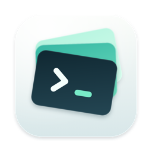

<p align="center">
  
</p>

# AgentDeck

macOS 14+ · Swift / SwiftUI · MIT · [kontsek.io/agentdeck](https://kontsek.io/agentdeck)

One native macOS window runs several AI agents side by side, with a shared task board and an MCP server so they coordinate without peering inside each other.

- CLI agents (Claude Code, Codex, Gemini CLI, Antigravity, Grok, plain shells) run in embedded PTY terminals.
- Web models (ChatGPT, Claude.ai, Gemini, Grok, Perplexity, any URL) run in browser panes with shared sign-ins.
- AgentDeck manages only sessions it created; subagents a CLI spawns stay inside their parent pane.

```
┌ ⊞ +  AgentDeck            grid|canvas  Normal  A ──●── 13        ☾ ((·)) ▭ ▯ ┐
│ · · · · · · · · · · · · · · · · · · · · · · · · · · · · · · · · · · · · · · · │
│ · ┌ ● Claude A  working ─ ~/repo ─ 13 ⋯┐ · · ┌ ● ChatGPT  idle ─────────⋯┐ · │
│ · │ working 42s · up 12m · Opus 4 · ctx │ · · │ (isolated WKWebView)       │ · │
│ · │ 31% · 2 open: #3 #5 · 13 pt         │ · · │                            │ · │
│ · │  (PTY terminal)                      │ · · └────────────────────────────┘ · │
│ · └──────────────────────────────────────┘ · · · · ┌ ● Codex B  idle ─────⋯┐ · │
│ · · · · · · · · · · · · · · · · · · · · · · · · ·  │  (PTY terminal)        │ · │
│ · · · · · · · · · · · · · · · · · · · · · · · · ·  └────────────────────────┘ · │
└───────────────────────────────────────────────────────────────────────────────┘
   Sessions sidebar (⌥⌘S), task board + log (⌥⌘B) and inspector (⌥⌘I) slide in on demand.
```

## 1. Requirements

- macOS 14 or newer: isolated `WKWebsiteDataStore(forIdentifier:)` profiles need 14+.
- Xcode 16 or newer with command line tools, including `swift-format` for lint/format.
- [xcodegen](https://github.com/yonaskolb/XcodeGen): `brew install xcodegen`.
- The only package dependency is [SwiftTerm](https://github.com/migueldeicaza/SwiftTerm), resolved by Xcode on first build.

## 2. Build and run

```sh
make run        # generate the Xcode project, build Release, open the app
make install    # copy the built app to /Applications
make build CONFIG=Debug
make test       # regression tests with isolated state, local PTYs and WebKit
make format     # Xcode swift-format
make lint       # strict style check
make check      # lint + tests + Release build
make clean
```

- `make` passes `-skipPackagePluginValidation` because SwiftTerm ships a build-tool plugin.
- The app is ad-hoc signed and not sandboxed: it spawns processes and binds a local port.
- Architecture, verification coverage and manual checks live in the [wiki](wiki/Home.md).

## 3. Sessions

- An empty launch opens one interface per provider: Claude Code, Codex, Antigravity, Grok Build, Perplexity.
- Gemini CLI replaces Antigravity when that profile is absent; a browser preset replaces a missing CLI profile. All presets stay available in New Session.
- Saved sessions are restored without duplicates. Missing CLIs show install links; AgentDeck never installs tools or signs in for you.
- Settings → General controls the defaults and the CLI directory (`~/gitrepos`). Closing the last session leaves an empty canvas until relaunch or **Open default sessions**.
- New panes are Compact (440×300) with 11 pt text; new windows start at 1400×900. Saved sizes and fonts win.
- The first click in an inactive pane focuses it; later clicks reach its terminal or browser.

**New Session (⌘N)** creates one of:

- A **CLI session**: profile, working directory, optional isolated **git worktree** at `<worktree root>/<repo>/<session-slug>` on branch `agentdeck/<session-slug>`, a first prompt, and the **Orchestrator** role.
- A **browser session**: ChatGPT, Claude.ai, Gemini, Grok, Perplexity or any URL. **Shared AgentDeck** is the default profile: sign in once per service and other shared panes reuse the cookies. Sign-ins persist; signing out affects every shared pane for that service. **Separate account** gives a pane its own login. Switching profile reloads a running pane; stopped panes stay stopped.

Upgrades and persistence:

- Existing browser panes move to the shared profile. Their old individual data stays reachable through **Separate account**; nothing is merged, and Chrome sign-ins are not imported. Removing a shared pane keeps the shared profile.
- Sessions persist in `~/Library/Application Support/AgentDeck/state.json` and relaunch at start unless "Start at launch" is off.
- An exited session shows a Restart overlay. Sidebar and pane menus offer Restart / Stop / Remove, optionally deleting the worktree or browser profile.
- Worktree creation failure cancels the session. Deleting a dirty worktree is refused and the session kept. Unreadable state is preserved and reported, never overwritten.

Tabs:

- **+** or **⌘T** starts another instance of the pane's CLI in the same directory, always as a fresh conversation.
- Tabs have independent terminals, output, status, tasks and MCP identities; hidden tabs keep running.
- **⇧⌘[ / ⇧⌘]** cycles tabs; a tab's **×** closes only that session; closing the last tab removes the mini-window.
- New tabs inherit font and launch preferences, not the first prompt or the orchestrator role. **⌘N** still makes a separate mini-window.
- Position, size, tab order and selected tabs persist, also in Grid and maximized views.
- Tabs from a worktree share it; remove the other sessions using it before deleting the worktree.

### Status badges

| Badge | Meaning (CLI sessions) |
|---|---|
| Starting | process launched less than 2 s ago |
| Working | output in the last few seconds, or a busy indicator ("esc to interrupt", spinner, "Thinking") is on screen |
| Idle | no output for *Idle after quiet* seconds and no busy indicator |
| Waiting for user | a prompt such as `(y/n)`, "Do you want to…", "Enter to confirm", "1. Yes" is on screen |
| Stalled | a busy indicator is on screen but there has been no output for *Stalled after* seconds |
| Quota warning | "rate limit", "usage limit", "quota", "429", "overloaded" on screen |
| Error / Exited | process ended with non-zero / zero exit code |

- Detection is heuristic and reads only the **visible** rows; a prompt that scrolled away no longer counts.
- OSC 7501 program-status records (SwiftTerm) override the heuristics.
- Thresholds and patterns: Settings → Orchestration and `Sources/Services/StatusHeuristics.swift`.
- Browser sessions are Working while loading, otherwise Idle.

## 4. Font, layout and panes

| Control | Where |
|---|---|
| Global font size | toolbar slider, Settings → General (every CLI pane without an override) |
| Per-pane font | `−` `13` `+` in the pane header, inspector, or ⌘+ / ⌘= / ⌘− / ⌘0 on the focused pane (⌘0 = back to global) |
| Layout | toolbar: **Canvas** (default) makes every pane a movable mini-window; **Grid** tiles panes into N columns (stepper) |
| Move | Canvas: drag a pane by its header; it comes to the front; positions persist |
| Tidy | ⌥⌘T or toolbar: re-packs panes at their sizes, Claude CLI first, Codex second |
| Fill Canvas | ⌥⌘F or **Fill Canvas**: balanced rows across the visible canvas; tiny canvases scroll to keep readable minimums |
| Pane presets | Compact / Normal / Large: toolbar (default for all), pane menu, inspector, View → Pane Size |
| Drag to resize | Canvas: drag the bottom-right grip; double-click it to reset |
| Maximize | ⇧⌘M toggles |
| Side panels | all collapsed by default: sidebar ⌥⌘S, inspector ⌥⌘I, task board + log ⌥⌘B, or toolbar toggles |
| Theme | ⌥⌘D flips light/dark; System / Light / Dark in View → Appearance or Settings; terminals and web panes follow |

Focused pane stats:

- The strip under the header shows status with time in state, uptime, CLI, model and context, worktree branch, open tasks, pending question, OSC 7501 program status and effective font size.
- Model and context (for example `Opus 4.1`, `63% context left`) are scraped from the CLI's own status line via `StatusHeuristics.modelStats`, so they appear only when the CLI prints them.
- Browser panes show page title and host. The inspector (⌥⌘I) shows the same data plus controls.
- Every change applies immediately and is saved.

## 5. Orchestration

### MCP server

- Streamable-HTTP MCP server on `http://127.0.0.1:4820` (port in Settings), one endpoint per session: `http://127.0.0.1:4820/mcp/<session-id>`.
- `GET http://127.0.0.1:4820/` returns a JSON snapshot of sessions and tasks for debugging.
- Tool calls need a known session endpoint. Host and Origin are validated; foreign web origins are rejected.
- Local processes are trusted: session IDs identify, they do not authenticate against hostile local apps. See [SECURITY.md](SECURITY.md).

Every CLI session gets:

| Variable | Value |
|---|---|
| `AGENTDECK_SESSION_ID`, `AGENTDECK_SESSION_NAME` | identity |
| `AGENTDECK_MCP_URL` | the session's endpoint |
| `AGENTDECK_MCP_CONFIG` | path to `{"mcpServers":{"agentdeck":{"type":"http","url":…}}}` |
| `AGENTDECK_BRIEFING` | path to the session's Markdown briefing (identity, tools, board, skills) |

Built-in profiles:

| Profile | Launch command | MCP |
|---|---|---|
| Claude Code | `claude --dangerously-skip-permissions --mcp-config "{mcpConfigPath}" --append-system-prompt-file "{briefingPath}"` | automatic |
| Codex | `codex --dangerously-bypass-approvals-and-sandbox -c 'mcp_servers.agentdeck.url="{mcpUrl}"'` | automatic |
| Gemini CLI | `gemini --yolo` | once: `gemini mcp add -t http -s user agentdeck $AGENTDECK_MCP_URL` |
| Antigravity | `agy --dangerously-skip-permissions` | configure a remote server in `/mcp` with the session MCP URL |
| Grok Build | `grok --always-approve` | configure with `grok mcp` using `$AGENTDECK_MCP_URL` |
| Plain shell | `exec $SHELL -l` | none; shells never receive briefings |

- Agent profiles bypass tool permission prompts by default; Codex also bypasses its sandbox. Edit the commands in Settings → CLI Profiles.
- A one-time upgrade rewrites unchanged older built-in commands only; custom commands and later edits survive. Running sessions pick up changes on restart.

### Continuing the last conversation

| Profile | Resume command | Detected from |
|---|---|---|
| Claude Code | `claude --continue …` | `~/.claude/projects/<encoded directory>/*.jsonl` |
| Codex | `codex resume --last …` | `~/.codex/sessions/**/rollout-*.jsonl` whose `cwd` matches |
| Gemini CLI | `gemini --yolo --resume latest` | `~/.gemini/tmp/<directory name>/chats/` |

- A session whose directory has a prior conversation runs the profile's resume command instead of its command.
- A directory without one starts fresh. A resumed session is not briefed again and does not get its first prompt again.
- Disable per session via the inspector's "Continue last conversation on start" or at creation; clear a profile's resume command to disable it for that profile.
- Focused session and pane tabs are restored at launch regardless.

### Tools

| Tool | Purpose |
|---|---|
| `whoami` | the caller's own session record |
| `list_sessions` | every managed session with status, directory, pending question, open task ids |
| `read_board` | the task board (optional `status` filter) |
| `list_skills` / `read_skill` | list enabled local skills and read their instructions by exact skill ID |
| `create_task` | add a task (`title`, `description`, `owner`, `status`, `notes`) |
| `update_task` | claim (`owner: "me"`), change `status`, append `notes`, edit title/description |
| `handoff` | assign a task to another session and type a handoff message into its input (queued until idle) |
| `send_message` | type a free-form single-line note into another CLI session |
| `log` | append to the orchestration log |
| `recruit_session` / `recruit_status` | **Orchestrator only**: ask the user to approve a new session (approve/deny in the sidebar) |
| `browser_navigate` / `browser_read` / `browser_click` / `browser_type` / `browser_screenshot` / `browser_eval` | **CLI sessions only**: drive the caller's private browser |

Sessions are addressed by name, id, id prefix or `"me"`.

### Private browsers for agents

- Agents never use your own browser. The first `browser_*` call opens a WebKit tab beside the terminal (`<session> browser`, globe icon) with its own isolated website data store.
- Sessions cannot see each other's cookies or sign-ins; the companion profile cannot be switched to the shared one.
- The tab opens without stealing focus; click it to watch or help, for example to sign in once. Removing the CLI session removes the browser and deletes its profile.
- The orchestration log records browser calls without typed text, scripts or URL query strings.
- `browser_navigate` loads a URL and waits; `browser_read` returns visible text, links or HTML; `browser_click` targets a CSS selector or visible text; `browser_type` fills a field and can press Enter; `browser_eval` runs JavaScript; `browser_screenshot` returns a PNG.
- A hidden tab keeps working: it is parked off-screen inside the main window and occlusion detection is off, so it renders while other windows cover AgentDeck. Screenshots still need the AgentDeck window to exist.
- This separates agents' web sessions from each other and from you. It is not a sandbox: see [SECURITY.md](SECURITY.md).

### How agents learn about each other

- **Briefing.** Before launch AgentDeck writes `~/Library/Application Support/AgentDeck/briefing/<id>.md`: identity, directory, tools, the board and the skill catalog. Claude Code loads it with `--append-system-prompt-file "{briefingPath}"`, so nothing appears in the terminal.
- Profiles without `{briefingPath}` in their command are typed one line the first time they go idle: `[AgentDeck] Read your briefing at <path> before working.`, followed by the first prompt if set. `AGENTDECK_BRIEFING` also points at the file.
- **Status summaries** are never broadcast automatically; each costs the agent a turn. "Inject Context Now" (Session menu, pane menu, inspector) sends the focused session one line like `[AgentDeck status] Sessions: Claude A (idle, you), Codex B (working). Open tasks: 2 — #3 "Fix login" (in-progress, Codex B)…`. The per-session "Include status summary in start-up briefing" toggle affects only the briefing.
- **Handoffs** arrive as `[AgentDeck handoff from X] Task #N: … update_task(task_id=N, status=in-progress, owner=me)`.
- **Inject Note (⇧⌘I)** types anything into the focused session as if you had typed it.
- Injected text is typed into the PTY, then Enter after the profile's *submit delay*. Newlines collapse to one line; control characters are dropped.
- A busy target queues the message until its next idle tick. Stopped sessions reject messages.
- Profiles with *Speaks MCP* off reject automated messages; their handoffs are board assignments only. User-entered notes and first prompts still work.

### A typical agent workflow

```
read_board                     → see open work
update_task(task_id=4, owner="me", status="in-progress")
… do the work …
update_task(task_id=4, status="done", notes="PR #12 opened")
handoff(target_session="Codex B", title="Review PR #12", note="focus on the auth middleware")
```

An Orchestrator can also call `recruit_session(name="Tests", cli_profile="codex", use_worktree=true, initial_prompt="Run the test suite and report failures to the board")`; the request waits in the sidebar for approval.

## 6. Adding a CLI type

- Settings → **CLI Profiles** → `+`. A profile is a zsh snippet run as `zsh -l -i -c "<command>"` in the session directory.
- Placeholders: `{mcpUrl}` `{mcpConfigPath}` `{briefingPath}` `{sessionId}` `{sessionName}` `{cwd}`. A *resume command* takes the same placeholders.
- Include `{briefingPath}` when the CLI accepts a system-prompt file; the briefing is then never typed.
- Placeholders are inserted as literal data in unquoted, single-quoted and double-quoted arguments. Use environment variables for here-documents and nested substitutions.
- Set *Submit delay* when the CLI needs a pause before Enter (Ink TUIs want ~150 ms). Turn off *Speaks MCP* where typed text would be executed.
- Profiles live in `state.json`; built-ins are re-added if missing.

```
my-agent --mcp-http agentdeck={mcpUrl} --name "{sessionName}"
```

## 7. Shared skill directories

- Settings → **Skills** loads folders or repositories containing `.agents/skills`, `.claude/skills`, `.codex/skills`, `.gemini/skills` or `skills`. Defaults: `~/gitrepos` and `~/.codex/skills`.
- Add or remove folders, enable individual skills, preview instructions, open source files, reload after edits.
- AgentDeck writes `~/Library/Application Support/AgentDeck/skills/catalog.md`, exports `AGENTDECK_SKILLS_FILE` and JSON `AGENTDECK_SKILL_DIRECTORIES`, and points agents to relevant skills in their briefing. MCP clients call `list_skills` and `read_skill`.
- Provider configuration and repositories are never modified; no provider-native slash commands are registered.
- Running agent: **Use in focused CLI**. Browser chat: **Copy for browser** and paste; a browser chat cannot read local skill scripts through the catalog.

## 8. Image generation

- Codex interactive sessions generate images when the account and tool configuration allow; describe the image or request `$imagegen`. Antigravity has its own generative image tool.
- AgentDeck only hosts the interfaces; availability and limits belong to the provider. A Gemini browser subscription configures no API key and no other client's tools.
- Docs: [Codex image generation](https://learn.chatgpt.com/docs/image-generation), [Antigravity models and tools](https://www.antigravity.google/docs/models/).

## 9. Files

| Path | Contents |
|---|---|
| `Sources/App` | app entry, menu commands |
| `Sources/Models` | sessions, tasks, settings, CLI profiles |
| `Sources/Store/AppStore.swift` | single source of truth: lifecycle, persistence, status loop, injection, handoffs, recruits |
| `Sources/Terminal` | SwiftTerm PTY host and SwiftUI wrapper |
| `Sources/Browser` | isolated WKWebView host and pane, agent browser tools and page scripts |
| `Sources/MCP` | loopback HTTP server, JSON-RPC routing, tool definitions |
| `Sources/Services` | status heuristics, git worktree helpers |
| `Sources/Views` | sidebar, pane grid, board, log, inspector, sheets, settings |
| `scripts/make-icon.swift` | renders the app icon; `make icon` rebuilds `Resources/AppIcon.icns` |
| `~/Library/Application Support/AgentDeck/` | `state.json`, per-session `mcp/*.json`, `briefing/*.md`, `skills/catalog.md` |
| `~/.agentdeck/worktrees/` | default worktree root (Settings) |
| `~/Downloads` | default browser download folder (Settings → General) |

Downloads: browser panes save into the configured folder, keep the file name, append ` (1)`, ` (2)`, … on collision, and never leave that folder.

## 10. Known limitations

- Status detection is heuristic; an unusual prompt can show Working while the CLI waits. Add patterns in `StatusHeuristics.swift`.
- Injection types a single line; multi-line notes are collapsed.
- The MCP transport answers plain JSON, no SSE; `GET /mcp` returns 405, which clients handle.
- HTTP/1.1 with Content-Length only: no chunked requests, no pipelining; every response closes its connection. Limits: 16 KiB headers, 1 MiB bodies, 15-second connection deadline.
- A recruit request shows as an orange "approval" badge in the toolbar while the sidebar is hidden.
- Some providers restrict embedded sign-in. Shared profiles reuse AgentDeck sign-ins but bypass no provider restriction and import no Chrome session.
- Browser sessions receive handoffs on the board only; nothing is typed into web UIs.
- A nested launch strips `CLAUDE*`/`CODEX_*` variables so Claude Code starts inside another Claude Code session.

## 11. Security and license

- Threat model, loopback MCP guarantees and vulnerability reporting: [SECURITY.md](SECURITY.md).
- License: [MIT](LICENSE).
