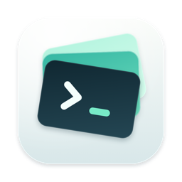

<p align="center">
  
</p>

# AgentDeck

macOS 14+ · Swift / SwiftUI · MIT · [kontsek.io/agentdeck](https://kontsek.io/agentdeck)

One native macOS window runs several AI agents side by side, with a shared task board and an MCP server so they coordinate without peering inside each other.

- **Work** is the primary workspace: tasks, dependencies, shared evidence, handoff packages, and user approvals. **Sessions** keeps the native grid/canvas desk one click away.
- **CLI usage** is a movable, resizable mini-window with account usage, limits, reset dates, freshness, and session status. Toggle it with **⌥⌘U**.
- The menu-bar item shows managed CLI status and attention requests. **⌃⌥⌘Space** brings forward work needing attention.
- Panels, workspace changes, disclosures, and pane open/close/maximize transitions animate; macOS Reduce Motion disables motion. Native terminal views keep stable identities across layouts.

- CLI agents (Claude Code, Codex, Gemini CLI, Antigravity, Grok, plain shells) run in embedded PTY terminals.
- Web models (ChatGPT, Claude.ai, Gemini, Grok, Perplexity, any URL) run in browser panes with shared sign-ins.
- **Connected subagent windows** run substantial tasks in independent movable/resizable mini-windows while the main conversation returns to prompting. Each owner’s browser tabs stay inside its window. Rounded right-angle routes with filled arrowheads and a configurable color and labeled navigation show parent → worker; see `wiki/Connected-Mini-Windows.md`.
- Provider-internal subagents remain inside that provider's terminal; managed tabs are created through AgentDeck's `delegate_task` tool.

```
┌ ⊞ +  AgentDeck            grid|canvas  Normal  A ──●── 13        ☾ ((·)) ▭ ▯ ┐
│ · · · · · · · · · · · · · · · · · · · · · · · · · · · · · · · · · · · · · · · │
│ · ┌ ● Claude A  working ─ ~/repo ─ 13 ⋯┐ · · ┌ ● ChatGPT  idle ─────────⋯┐ · │
│ · │ working 42s · up 12m · Opus 4 · ctx │ · · │ (native WKWebView)         │ · │
│ · │ 31% · 2 open: #3 #5 · 13 pt         │ · · │                            │ · │
│ · │  (PTY terminal)                      │ · · └────────────────────────────┘ · │
│ · └──────────────────────────────────────┘ · · · · ┌ ● Codex B  idle ─────⋯┐ · │
│ · · · · · · · · · · · · · · · · · · · · · · · · ·  │  (PTY terminal)        │ · │
│ · · · · · · · · · · · · · · · · · · · · · · · · ·  └────────────────────────┘ · │
└───────────────────────────────────────────────────────────────────────────────┘
   Sessions sidebar (⌥⌘S), task board + log (⌥⌘B) and inspector (⌥⌘I) slide in on demand.
```

## 1. Requirements

- macOS 14 or newer: persistent `WKWebsiteDataStore(forIdentifier:)` profiles need 14+.
- Xcode 16 or newer with command line tools, including `swift-format` for lint/format.
- [xcodegen](https://github.com/yonaskolb/XcodeGen): `brew install xcodegen`.
- The only package dependency is [SwiftTerm](https://github.com/migueldeicaza/SwiftTerm), resolved by Xcode on first build.

## 2. Build and run

```sh
make run        # generate the Xcode project, build Release, open the app
make install    # copy the built app to /Applications
make build CONFIG=Debug
make test       # regression tests with isolated state, local PTYs and WebKit
make format     # Xcode swift-format
make lint       # strict style check
make check      # lint + tests + Release build
make clean
```

- `make` passes `-skipPackagePluginValidation` because SwiftTerm ships a build-tool plugin.
- The app is ad-hoc signed and not sandboxed: it spawns processes and binds a local port.
- Architecture, verification coverage and manual checks live in the [wiki](wiki/Home.md).

## 3. Sessions

- An empty launch opens one interface per provider: Claude Code, Codex, Antigravity, Grok Build, Perplexity.
- Gemini CLI replaces Antigravity when that profile is absent; a browser preset replaces a missing CLI profile. All presets stay available in New Session.
- Saved sessions are restored without duplicates. Missing CLIs show install links; AgentDeck never installs tools or signs in for you.
- Settings → General controls the defaults and the CLI directory (`~/gitrepos`). Closing the last session leaves an empty canvas until relaunch or **Open default sessions**.
- At startup, all mini-windows fit the visible canvas. Terminal text scales with window size; browsers fit page width with vertical scrolling. Existing manual text/zoom overrides remain fixed. New windows start at 1400×900.
- Terminal/browser splits are on by default; Window actions can switch to single-tab mode. Double-click a window’s top bar to fill the canvas and double-click again to restore its position and size.
- **Demo mode** in the toolbar replaces private main-window content with synthetic text for screenshots while sessions keep running. Toggle off to return to live content.
- The first click in an inactive pane focuses it; later clicks reach its terminal or browser.

**New Session (⌘N)** creates one of:

- A **CLI session**: profile, working directory, optional isolated **git worktree** at `<worktree root>/<repo>/<session-slug>` on branch `agentdeck/<session-slug>`, a first prompt, and the **Orchestrator** role.
- A **browser session**: ChatGPT, Claude.ai, Gemini, Grok, Perplexity or any URL. **Shared AgentDeck** is the default profile: sign in once per service and other shared panes reuse the cookies. Sign-ins persist; signing out affects every shared pane for that service. **Separate account** gives a pane its own login. Switching profile reloads a running pane; stopped panes stay stopped.

Upgrades and persistence:

- Existing ordinary browser panes and pre-0.1.13 agent companion panes move to the shared profile once. Their old individual data stays reachable through **Separate account**; nothing is merged, and Chrome sign-ins are not imported. Removing a shared pane keeps the shared profile.
- Sessions persist in `~/Library/Application Support/AgentDeck/state.json` and relaunch at start unless "Start at launch" is off.
- CLI panes resume their own saved conversation after restart when supported. Browser panes reopen their last visited URL, including chat-page navigation, with the existing sign-in profile.
- An exited session shows a Restart overlay. Sidebar and pane menus offer Restart / Stop / Remove, optionally deleting the worktree or browser profile.
- Worktree creation failure cancels the session. Deleting a dirty worktree is refused and the session kept. Unreadable state is preserved and reported, never overwritten.

Tabs:

- **+** or **⌘T** starts another instance of the pane's CLI in the same directory, always as a fresh conversation.
- Tabs have independent terminals, output, status, tasks and MCP identities; hidden tabs keep running.
- **⇧⌘[ / ⇧⌘]** cycles tabs; a tab's **×** closes only that session; closing the last tab removes the mini-window.
- New tabs inherit font and launch preferences, not the first prompt or the orchestrator role. **⌘N** still makes a separate mini-window.
- Position, size, tab order and selected tabs persist, also in Grid and maximized views.
- Tabs from a worktree share it; remove the other sessions using it before deleting the worktree.

### Status badges

| Badge | Meaning (CLI sessions) |
|---|---|
| Starting | process launched less than 2 s ago |
| Working | output in the last few seconds, or a busy indicator ("esc to interrupt", spinner, "Thinking") is on screen |
| Idle | no output for *Idle after quiet* seconds and no busy indicator |
| Waiting for user | a prompt such as `(y/n)`, "Do you want to…", "Enter to confirm", "1. Yes" is on screen |
| Stalled | a busy indicator is on screen but there has been no output for *Stalled after* seconds |
| Quota warning | "rate limit", "usage limit", "quota", "429", "overloaded" on screen |
| Error / Exited | process ended with non-zero / zero exit code |

- Detection is heuristic and reads only the **visible** rows; a prompt that scrolled away no longer counts.
- OSC 7501 program-status records (SwiftTerm) override the heuristics.
- Thresholds and patterns: Settings → Orchestration and `Sources/Services/StatusHeuristics.swift`.
- Browser sessions are Working while loading, otherwise Idle.

## 4. Font, layout and panes

| Control | Where |
|---|---|
| Base text size | toolbar slider, Settings → General (automatic scaling uses a normal 640×440 window as reference and stops at this size) |
| Per-pane font | `−` / `+`, Window actions → Text size, inspector, or ⌘+ / ⌘= / ⌘−; ⌘0 restores automatic scaling |
| Layout | toolbar: **Canvas** (default) makes every pane a movable mini-window; **Grid** tiles panes into N columns (stepper) |
| Move | Canvas: drag a pane by its header; it comes to the front; positions persist |
| Tidy | ⌥⌘T or toolbar: re-packs panes at their sizes, Claude CLI first, Codex second |
| Fill Canvas | ⌥⌘F or **Fill Canvas**: balanced rows fitting every mini-window into the visible canvas |
| Pane presets | Compact / Normal / Large: toolbar (default for all), pane menu, inspector, View → Pane Size |
| Drag to resize | Drag the bottom-right grip, including CLI usage; double-click the bottom-right grip to reset. Resizing a tiled pane switches to Canvas without moving other panes. |
| Dotted background | Grid and Canvas both show the website's 16-point dot pattern; white in dark appearance, dark in light appearance. |
| Maximize | ⇧⌘M toggles |
| Side panels | all collapsed by default: sidebar ⌥⌘S, inspector ⌥⌘I, task board + log ⌥⌘B, or toolbar toggles |
| Arrow color | Settings → General → Appearance → Canvas arrows; independent of the focus border |
| Theme | ⌥⌘D flips light/dark; System / Light / Dark in View → Appearance or Settings; terminals and web panes follow |

Focused pane stats:

- The strip under the header shows status with time in state, uptime, CLI, model and context, worktree branch, open tasks, pending question, OSC 7501 program status and effective font size.
- Model and context (for example `Opus 4.1`, `63% context left`) are scraped from the CLI's own status line via `StatusHeuristics.modelStats`, so they appear only when the CLI prints them.
- Browser panes show page title and host. The inspector (⌥⌘I) shows the same data plus controls.
- Every change applies immediately and is saved.

## 5. Orchestration

### MCP server

- Streamable-HTTP MCP server on `http://127.0.0.1:4820` (port in Settings), one endpoint per session: `http://127.0.0.1:4820/mcp/<session-id>`.
- `GET http://127.0.0.1:4820/` returns a JSON snapshot of sessions and tasks for debugging.
- Tool calls need a known session endpoint. Host and Origin are validated; foreign web origins are rejected.
- Local processes are trusted: session IDs identify, they do not authenticate against hostile local apps. See [SECURITY.md](SECURITY.md).

Every CLI session gets:

| Variable | Value |
|---|---|
| `AGENTDECK_SESSION_ID`, `AGENTDECK_SESSION_NAME` | identity |
| `AGENTDECK_MCP_URL` | the session's endpoint |
| `AGENTDECK_MCP_CONFIG` | path to `{"mcpServers":{"agentdeck":{"type":"http","url":…}}}` |
| `AGENTDECK_BRIEFING` | path to the session's Markdown briefing (identity, tools, board, skills) |

Built-in profiles:

| Profile | Launch command | MCP |
|---|---|---|
| Claude Code | `claude --dangerously-skip-permissions --mcp-config "{mcpConfigPath}" --append-system-prompt-file "{briefingPath}"` | automatic |
| Codex | `codex --dangerously-bypass-approvals-and-sandbox -c 'mcp_servers.agentdeck.url="{mcpUrl}"'` | automatic |
| Gemini CLI | `gemini --yolo` | once: `gemini mcp add -t http -s user agentdeck $AGENTDECK_MCP_URL` |
| Antigravity | `agy --dangerously-skip-permissions` | configure a remote server in `/mcp` with the session MCP URL |
| Grok Build | `grok --always-approve` | configure with `grok mcp` using `$AGENTDECK_MCP_URL` |
| Plain shell | `exec $SHELL -l` | none; shells never receive briefings |

- Agent profiles bypass tool permission prompts by default; Codex also bypasses its sandbox. Edit the commands in Settings → CLI Profiles.
- A one-time upgrade rewrites unchanged older built-in commands only; custom commands and later edits survive. Running sessions pick up changes on restart.

### Resuming after restart

| Profile | Restart command | Identity source |
|---|---|---|
| Claude Code | `claude --resume <conversation ID> …` | The managed process's local Claude PID record |
| Codex | `codex resume <conversation ID> …` | The managed process's open rollout filename |
| Grok Build | `grok --resume <conversation ID> …` | The managed process's open session filename |
| Gemini CLI | `gemini --yolo --resume latest` | Best-effort directory history; only with one managed Gemini pane |

- **Resume this session after restart** defaults on, including for tabs that start fresh. Exact IDs keep agents sharing a directory in separate conversations.
- **Use latest conversation on first start** controls the initial launch separately. New CLI tabs keep it off; unknown directory-wide history is never shared automatically between managed panes.
- Identity checkpoints live in `~/Library/Application Support/AgentDeck/resume/<session ID>.json`. AgentDeck refreshes them while the provider runs and before a normal quit. They contain only the provider, directory, launch time, conversation ID and file path; conversation bodies are not copied or published.
- Missing or ambiguous exact history starts a fresh session with a log notice. Restart never repeats the original task prompt. Resumed conversations receive no typed briefing.
- Clear a profile's resume command to disable resume for that profile. Plain shells and providers without a verified resume connector start normally; in-flight terminal processes cannot survive quitting the app.
- Custom command text stays unchanged. A custom resume command can use `{conversationId}` when Claude/Codex/Grok metadata tracking supplies one. Standard exact-ID commands are used only with unchanged built-in profiles.
- Focused session, pane tabs, geometry and browser sign-in profiles restore independently of conversation resumption.

### Tools

| Tool | Purpose |
|---|---|
| `whoami` | the caller's own session record |
| `list_sessions` | every managed session with status, directory, pending question, open task ids |
| `read_board` | the task board (optional `status` filter) |
| `list_skills` / `read_skill` | list enabled local skills and read their instructions by exact skill ID |
| `create_task` | add a task (`title`, `description`, `owner`, `status`, `notes`) |
| `update_task` | claim (`owner: "me"`), change `status`, append `notes`, edit title/description |
| `handoff` | prepare a persistent context package; user approval may precede delivery; ownership changes only when accepted |
| `read_handoffs` | participants and orchestrators read explicitly shared packages and delivery history |
| `accept_handoff` | the named recipient accepts responsibility or declines; repeated acceptance is safe |
| `send_message` | durably enqueue a peer message; supply a unique `message_id` and reuse it on retries |
| `read_inbox` / `acknowledge_inbox` | read and acknowledge your own stable event IDs; no terminal input |
| `log` | append to the orchestration log |
| `recruit_session` / `recruit_status` | **Orchestrator only**: ask the user to approve a new session (approve/deny in the sidebar) |
| `browser_navigate` / `browser_read` / `browser_click` / `browser_type` / `browser_screenshot` / `browser_eval` | **CLI sessions only**: drive the caller's own browser tab |

Sessions are addressed by name, id, id prefix or `"me"`.

### Work, handoffs and approvals

- Settings → Orchestration controls automatic subagents (on by default), concurrent workers per conversation (default 20; range 1–20), and independent worker windows. Each worker starts a fresh CLI conversation using the parent's profile and directory/worktree, without taking focus.
- The parent receives instructions to delegate substantial work and end its turn promptly; quick replies stay in the main conversation. This depends on the CLI agent following its briefing. Workers receive the task objective, published notes and explicit instructions; they report evidence through `report_subagent_result`.
- Delegation accepts only the parent's own or unassigned tasks with completed dependencies and no open handoff. Workers cannot spawn more workers. Results remain subject to completion approval; an early process exit blocks the task and frees its worker slot. Up to 40 workers are retained per parent; close old worker windows to make room.
- New Task can immediately run a ready To do/In progress task in a subagent. Closing a parent promotes surviving workers to normal tabs. All workers share the inherited directory, so task scopes should avoid overlapping edits.

- Task states are `todo`, `in-progress`, `review`, `awaiting-approval`, `blocked`, and `done`. New tasks require user approval for completion; an agent's `done` request becomes `awaiting-approval`. Existing saved tasks retain their previous completion behavior. Users can change the requirement in Edit Task.
- Tasks can depend on other tasks. Cycles and unknown dependencies are rejected; unfinished dependencies prevent agent work from starting or completing. A dependency cannot be deleted while another task references it.
- Agents may update their own tasks or claim unassigned work. Orchestrators can manage tasks, but neither role can approve completion through MCP. Use `handoff` to transfer ownership; direct assignment to another agent is rejected.
- A handoff snapshots the task objective and published notes plus a summary, constraints, explicit artifact paths/URLs, verification, and next action. AgentDeck never assembles it from terminal transcripts, cookies, or browser pages, and never opens artifact files automatically.
- Settings → Orchestration → **Approve agent handoffs before delivery** defaults on. The user reviews the package on the board. User-composed handoffs are approved when sent.
- Delivery uses a separate durable inbox: approval → queued → inbox acceptance → recipient acceptance/decline. Worker messages, results, context and handoff notices never type into terminal input. Pending events attach automatically to the recipient’s next AgentDeck MCP result; `read_inbox` / `acknowledge_inbox` expose stable IDs and explicit receipt. Idle CLIs are not force-woken, and receipt does not prove processing or task completion. Stopped sessions keep their inbox; replacement tabs cannot inherit it.
- The recipient calls `read_handoffs(handoff_id=...)`, then `accept_handoff(handoff_id=..., accept=true)` to take ownership. A changed task revision rejects stale context; cancel and prepare a fresh handoff. Retries resend the notification, not the work.
- The board shows each task's history, packages, approval controls, and links to its sessions. **⌥⌘1** opens Work; **⌥⌘2** opens Sessions.

### CLI usage, limits and resets

The mini-window groups every CLI profile currently used by managed sessions. Account quotas are displayed once per provider, never summed across panes. Session context percentages remain separate from subscription usage.

| Provider | Source and limits |
| --- | --- |
| Codex | A short-lived `codex app-server` client calls `account/rateLimits/read`. Shows reported quota buckets, reset dates and available earned resets; never consumes a reset or starts a model turn. |
| Claude Code | Reads the existing default OAuth credential from Keychain or the CLI credential file, then calls the provider's usage endpoint. No interactive Keychain prompts, credential writes or login refreshes. |
| Gemini CLI | Reads the existing default OAuth credential and queries Code Assist health/quota endpoints. An expired login is reported; the user refreshes it through the CLI. No onboarding or project creation. |
| Grok, Antigravity, custom CLIs | Show session status and an explicit unavailable state for account fields without a supported connector. Grok's `/usage` UI exposes account information; its `usage` subcommand reports session tokens instead. |

- Uses each CLI's **default local sign-in**; custom environment/account configurations may differ. Subscription connectors do not imply support for API-key billing quotas.
- Refreshes every 60 seconds while visible, with manual refresh. Reopening reuses fresh samples; cancelled reads can retry immediately. Claude credentials remain only in memory for up to five minutes and are invalidated on authentication failure. If Keychain requires interaction, usage shows unavailable instead of opening an access dialog. Errors retain the last known sample, marked stale; missing data is never displayed as zero usage.
- Credentials and responses stay in memory and are not exposed through MCP or written to workspace state. Browser cookies are not used. Reset timestamps use the Mac's local timezone; an elapsed reset waits for provider confirmation.
- Codex contract: [official app-server documentation](https://learn.chatgpt.com/docs/app-server.md). Claude/Gemini adapters follow the installed CLI's current usage contracts and may require updates if providers change them.

### Agent browsers and shared sign-ins

- The first `browser_*` call opens an agent-owned browser tab inside its terminal’s mini-window (`<session> browser`, globe icon). It uses the shared persistent AgentDeck sign-in profile by default; your external browser remains separate.
- Sign in to Google or another service once in a shared pane; ordinary and agent panes reuse that local session. Agents still control only their own tabs, but can use the same signed-in accounts. Choose **Separate account** from the browser toolbar or inspector for independent cookies.
- The tab opens without stealing focus. Removing a CLI removes only its owned browser tabs and preserves shared sign-ins. Old companion profiles remain available through Separate account after the one-time shared-profile migration.
- The orchestration log records browser calls without typed text, scripts or URL query strings.
- `browser_navigate` loads a URL and waits; `browser_read` returns visible text, links or HTML; `browser_click` targets a CSS selector or visible text; `browser_type` fills a field and can press Enter; `browser_eval` runs JavaScript; `browser_screenshot` returns a PNG.
- A hidden tab keeps working in its own off-screen rendering panel, which cannot become the key or main window. It stays outside the user's main-window responder chain; occlusion detection is off so automation and screenshots remain available while the tab is hidden.
- WebKit stores cookies and website data locally under your macOS account. AgentDeck does not store account passwords or bypass site expiry/revocation. Sharing is deliberate, and is not a sandbox: see [SECURITY.md](SECURITY.md).

### How agents learn about each other

- **Briefing.** Before launch AgentDeck writes `~/Library/Application Support/AgentDeck/briefing/<id>.md`: identity, directory, tools, the board and the skill catalog. Claude Code loads it with `--append-system-prompt-file "{briefingPath}"`, so nothing appears in the terminal.
- Codex receives the full briefing through `-c developer_instructions=...`; Grok uses additive `--rules`. These launch settings also apply on resume and conversation reset, without replacing the provider's built-in system prompt.
- Gemini and Antigravity load a persistent bootstrap section appended to `~/.gemini/GEMINI.md`. It requires reading the current process's `AGENTDECK_BRIEFING` before answering after a fresh start, resume or clear. Existing user instructions are preserved; outside AgentDeck the section does nothing. This route requires the agent to follow the bootstrap instruction and the provider to load its default global context file.
- Custom profiles without a briefing placeholder receive a pointer through startup argv or the durable inbox. Add a supported persistent instruction mechanism to both launch and resume templates to retain context after clearing. Existing running processes need a restart after upgrading; unchanged shipped profiles migrate automatically.
- **Status summaries** are never broadcast automatically; each costs the agent a turn. "Inject Context Now" (Session menu, pane menu, inspector) queues a status event for the focused session like `[AgentDeck status] Sessions: Claude A (idle, you), Codex B (working). Open tasks: 2 — #3 "Fix login" (in-progress, Codex B)…`. The per-session "Include status summary in start-up briefing" toggle affects only the briefing.
- **Handoffs** arrive as a short notification containing a task and handoff ID. The recipient reads its published package and explicitly accepts through MCP.
- **Inject Note (⇧⌘I)** types anything into the focused session as if you had typed it.
- Only explicit **Inject Note** text uses negotiated terminal paste, then Enter after the profile's *submit delay*. Newlines collapse to one line; control characters are dropped. Background coordination never uses this path.
- Worker events queue independently of idle/busy status and survive process stop/restart. The next AgentDeck MCP tool result carries them automatically; an idle TUI is not force-woken. Explicit Inject Note still requires a running session.
- Profiles with *Speaks MCP* off reject automated messages and acknowledged handoffs. Explicit user-entered notes still work; automatic first prompts require a supported provider launcher or a custom `{initialPrompt}` argument.

### A typical agent workflow

```
read_board                     → see open work
update_task(task_id=4, owner="me", status="in-progress")
… do the work …
update_task(task_id=4, status="review", notes="PR #12 opened; auth tests pass")
handoff(target_session="Codex B", task_id=4, note="Ready for review", next_action="Review the auth middleware")
… user approves; recipient reads and accepts the handoff …
update_task(task_id=4, status="done", notes="Review passed")
… user approves completion on the board …
```

An Orchestrator can also call `recruit_session(name="Tests", cli_profile="codex", use_worktree=true, initial_prompt="Run the test suite and report failures to the board")`; the request waits in the sidebar for approval.

## 6. Adding a CLI type

- Settings → **CLI Profiles** → `+`. A profile is a zsh snippet run as `zsh -l -i -c "<command>"` in the session directory.
- Placeholders: `{mcpUrl}` `{mcpConfigPath}` `{briefingPath}` `{briefing}` `{briefingConfig}` `{sessionId}` `{sessionName}` `{cwd}`. A *resume command* also accepts `{conversationId}` for a captured provider conversation.
- Use `{briefingPath}` for an instruction file, `{briefing}` for literal briefing text, or `{briefingConfig}` for Codex's TOML-encoded `developer_instructions` assignment. Add the placeholder to both launch and resume commands; the briefing is then never typed.
- Placeholders are inserted as literal data in unquoted, single-quoted and double-quoted arguments. Use environment variables for here-documents and nested substitutions.
- *Submit delay* applies only to explicit Inject Note actions. Fresh initial tasks use provider launch arguments, with `{initialPrompt}` available to custom commands. Turn off *Speaks MCP* for plain shells; background coordination requires MCP.
- Profiles live in `state.json`; built-ins are re-added if missing.

```
my-agent --mcp-http agentdeck={mcpUrl} --name "{sessionName}"
```

## 7. Shared skill directories

- Settings → **Skills** loads folders or repositories containing `.agents/skills`, `.claude/skills`, `.codex/skills`, `.gemini/skills` or `skills`. Defaults: `~/gitrepos` and `~/.codex/skills`.
- Paste a skills folder path or choose a folder. Search by name, description or path; use individual checkboxes or Enable shown/Disable shown. Toggle changes update the catalog and MCP access immediately without rescanning. Reload after file edits.
- Disabling a skill prevents future AgentDeck reads; it cannot erase instructions already loaded into a running agent's conversation.
- AgentDeck writes `~/Library/Application Support/AgentDeck/skills/catalog.md`, exports `AGENTDECK_SKILLS_FILE` and JSON `AGENTDECK_SKILL_DIRECTORIES`, and points agents to relevant skills in their briefing. MCP clients call `list_skills` and `read_skill`.
- Provider configuration and repositories are never modified; no provider-native slash commands are registered.
- Running agent: **Use in focused CLI**. Browser chat: **Copy for browser** and paste; a browser chat cannot read local skill scripts through the catalog.

## 8. Image generation

- Codex interactive sessions generate images when the account and tool configuration allow; describe the image or request `$imagegen`. Antigravity has its own generative image tool.
- AgentDeck only hosts the interfaces; availability and limits belong to the provider. A Gemini browser subscription configures no API key and no other client's tools.
- Docs: [Codex image generation](https://learn.chatgpt.com/docs/image-generation), [Antigravity models and tools](https://www.antigravity.google/docs/models/).

## 9. Files

| Path | Contents |
|---|---|
| `Sources/App` | app entry, menu commands |
| `Sources/Models` | sessions, tasks, settings, CLI profiles |
| `Sources/Store/AppStore.swift` | single source of truth: lifecycle, persistence, status loop, injection, handoffs, recruits |
| `Sources/Terminal` | SwiftTerm PTY host and SwiftUI wrapper |
| `Sources/Browser` | persistent shared/separate WKWebView profiles, agent browser tools and page scripts |
| `Sources/MCP` | loopback HTTP server, JSON-RPC routing, tool definitions |
| `Sources/Services` | status heuristics, git worktree helpers |
| `Sources/Views` | sidebar, pane grid, board, log, inspector, sheets, settings |
| `scripts/make-icon.swift` | renders the app icon; `make icon` rebuilds `Resources/AppIcon.icns` |
| `~/Library/Application Support/AgentDeck/` | `state.json`, per-session `mcp/*.json`, `briefing/*.md`, `skills/catalog.md` |
| `~/.agentdeck/worktrees/` | default worktree root (Settings) |
| `~/Downloads` | default browser download folder (Settings → General) |

Downloads: browser panes save into the configured folder, keep the file name, append ` (1)`, ` (2)`, … on collision, and never leave that folder.

## 10. Known limitations

- Status detection is heuristic; an unusual prompt can show Working while the CLI waits. Add patterns in `StatusHeuristics.swift`.
- Injection types a single line; multi-line notes are collapsed.
- The MCP transport answers plain JSON, no SSE; `GET /mcp` returns 405, which clients handle.
- HTTP/1.1 with Content-Length only: no chunked requests, no pipelining; every response closes its connection. Limits: 16 KiB headers, 1 MiB bodies, 15-second connection deadline.
- A recruit request shows as an orange "approval" badge in the toolbar while the sidebar is hidden.
- Some providers restrict embedded sign-in. Shared profiles reuse AgentDeck sign-ins but bypass no provider restriction and import no Chrome session.
- Handoffs require an MCP-enabled CLI recipient; browser sessions and plain shells cannot acknowledge them.
- A nested launch strips `CLAUDE*`/`CODEX_*` variables so Claude Code starts inside another Claude Code session.

## 11. Security and license

- Threat model, loopback MCP guarantees and vulnerability reporting: [SECURITY.md](SECURITY.md).
- License: [MIT](LICENSE).
